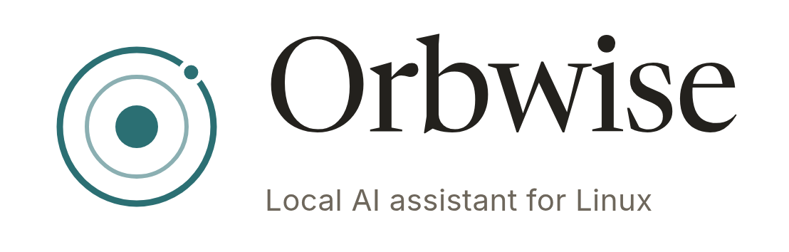
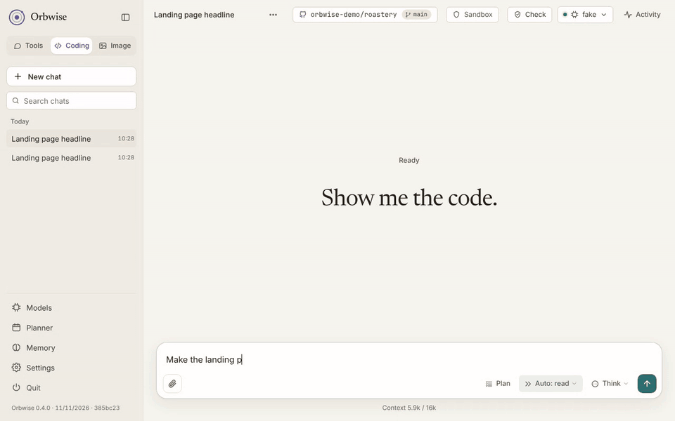
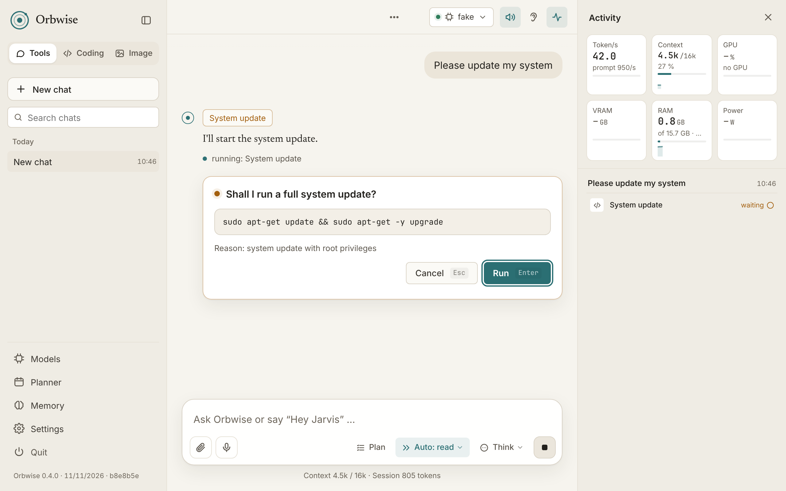
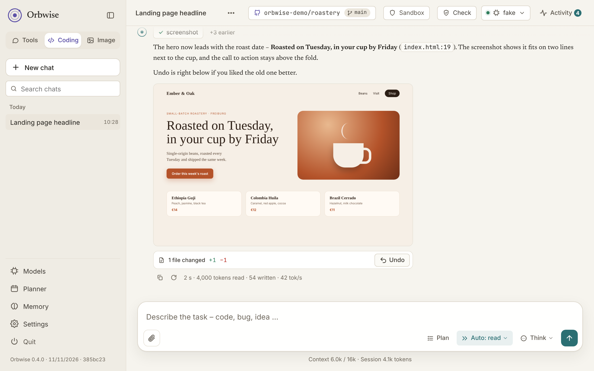
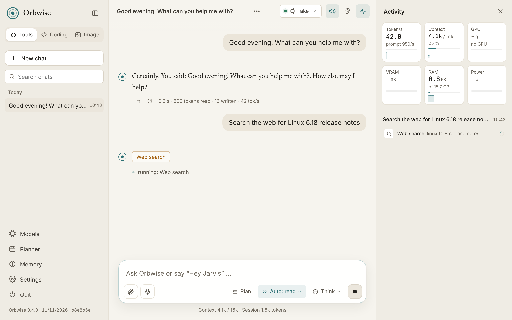

<p align="center">
  <picture>
    <source media="(prefers-color-scheme: dark)" srcset="docs/logo-dark.png">
    
  </picture>
</p>

<p align="center">
  <b>The local AI assistant you can trust with your Linux machine.</b>
</p>

<p align="center">
  
  
  
  
</p>

Orbwise runs a language model on your own GPU and gives it real hands on your system – updates, files, code, your
servers. It shows you the exact command or diff before anything changes, and nothing leaves the PC unless you use web
search or a service you set up.



## Why Orbwise

- **It asks first – and you can see why.** Every change appears as a card with the exact command or diff. Four levels
  decide what may run without asking, from *nothing* to *everything but root*; `sudo` always goes through a password
  dialog that shows what gets root; scripts and builds run in a cage without network. Content from web pages or
  mails cannot trigger actions on its own. → [Security](docs/security.md#security)
- **It runs on the hardware you have.** From 8 GB of video memory up: the prompt, the tools and the memory adapt to
  the context window. llama.cpp, speech recognition and speech output all run locally.
  → [Models](docs/models.md#models--profiles)
- **It measures itself.** `orbwise bench` lets the coding agent solve ten fixed tasks with your model and tells you
  what was solved, in how many steps and how long it took – so you know whether a model is any good as an agent
  before you rely on it. → [Benchmark](docs/models.md#does-the-agent-work-with-this-model-orbwise-bench)

## Quick start

```bash
git clone https://github.com/ressjo/orbwise-linux-agent.git ~/orbwise
~/orbwise/scripts/install.sh --lang en
orbwise serve --open
```

The installer detects your graphics card and proposes a model that fits. Details: [Installation](#installation).

## What it does

**Runs your PC – but asks.** "Update my system", "what is filling up my disk?", "restart the web server on the NAS":
read-only commands run directly, everything else waits for your click, key or voice. → [Security](docs/security.md#security)



**Writes code and looks at its own work.** In *Coding* the agent reads before it edits, makes small exact changes,
runs the project's tests before it says "done" and can be undone per answer. With the sandbox it works in a container
on its own copy and branch; `/goal` hands it a whole job. → [Coding mode](docs/coding.md#coding-mode)



**Remembers – without running out of context.** Every conversation lands in a plain Markdown journal, with daily
summaries and a `facts.md` you can edit by hand. A local search index brings old details back when they matter:
"what did we do with the NAS last Tuesday?" works weeks later. → [Memory](docs/memory.md#memory--without-context-window-problems)



**Speaks and listens, locally.** Whisper listens, Pocket TTS answers sentence by sentence – in German or English.
→ [Voice](docs/integrations.md#voice--voice-effect)

**Connects to what you already run.** Home Assistant, Paperless, mail, calendars, Docker, SSH, Telegram – and any
[MCP server](docs/integrations.md#mcp-servers-tools-from-other-programs).

## What it protects – and what it doesn't

Orbwise runs commands on your machine, so this is the part to read. The table is computed from the code
(`python -m orbwise.security_matrix`) and a test fails when it is out of date.

<!-- security-matrix:begin -->
|  | Off | Read only | Read + edit files | Auto |
|---|---|---|---|---|
| Reading: `ls`, `df`, `git status` | **asks** | runs | runs | runs |
| Create or change a file in your home | **asks** | **asks** | runs | runs |
| Scripts, builds, tests: `python3 x.py`, `npm test` | **asks** | **asks** | runs caged | runs |
| Deleting: `rm file` | **asks** | **asks** | **asks** | runs |
| Sending to the network: `curl -d @file …` | **asks** | **asks** | **asks** | runs |
| Changing start-up files: `~/.bashrc`, autostart | **asks** | **asks** | **asks** | runs |
| Reading credentials: `cat ~/.ssh/id_rsa` | **asks** | **asks** | **asks** | **asks** |
| The same file with the read tool | **never** | **never** | **never** | **never** |
| Root: `sudo …`, `su`, `pkexec`, `yay` | **asks** | **asks** | **asks** | **password dialog** |
| `git push` | **asks** | **asks** | **asks** | **asks** |
| `rm -rf /`, overwriting a disk, `chmod -R … /` | **never** | **never** | **never** | **never** |
<!-- security-matrix:end -->

Each protection – hidden instructions in web pages and mails, reading your keys, smuggling data out, root, destroying
the system – is a readable test in [`tests/test_attacks.py`](tests/test_attacks.py); the
[threat model](docs/security.md#threat-model) says which test proves what.

**It does not protect against:** approving a card without reading it · the level *Auto*, which lets everything but
root, pushing, mail and reading credentials run (including what a web page talks the model into) · passwordless sudo, where a script
calling sudo runs as root unasked in *Auto* · the `docker` group, which is root without a password · a kernel exploit
· a model that is simply wrong. `orbwise doctor --security` shows which of these apply on your machine.
→ [Details](docs/security.md#what-it-does-not-protect-against)

## Built with AI, checked by tests

Most of Orbwise's code was written with an AI coding assistant (Claude Code), directed, reviewed and used daily by a
human. What keeps it honest is not the author but the checks: more than 1,300 tests on every commit, the safety rules
in code instead of in the prompt, and a [benchmark](docs/models.md#does-the-agent-work-with-this-model-orbwise-bench)
that measures whether the agent solves real tasks with a given model.

## Skills

What Orbwise can do for you – each line links to the details. System, files, web, coding, memory, routines and voice
are the **core**; servers, smart home, documents, mail, notes, calendar and phone are optional **extras** that only
appear once you set them up.

| | |
|---|---|
| **System** | Updates (pacman/yay/paru, apt), packages, services and logs, processes, network, disk clean-up, shutdown – any shell command, with confirmation where it matters |
| **Files & NAS** | Find files by name or content, read and write them, open them in the right app – also on a mounted NAS |
| **Web** | Search (Brave Search API, SearXNG or ddgs), read pages – JavaScript pages and bot blocks via headless Chromium, with a screenshot only Orbwise sees – open websites → [Web search](docs/integrations.md#web-search) |
| **Servers** | Docker via Portainer (check and pull new images, update stacks) and SSH to other machines → [Docker](docs/integrations.md#docker-via-portainer) · [SSH](docs/integrations.md#ssh-nas-servers) |
| **Smart home** | Lights, heating, covers and sensors through Home Assistant → [Home Assistant](docs/integrations.md#home-assistant) |
| **Documents** | Paperless-ngx: search, ask about contents, tag and file → [Paperless](docs/integrations.md#paperless-ngx) |
| **Mail** | Proton Mail Bridge or any IMAP mailbox: read, sort, file attachments, optionally reply → [E-mail](docs/integrations.md#e-mail-proton-mail-bridge-or-any-imap-mailbox) |
| **Notes & calendar** | Obsidian, Trilium, iCloud/CalDAV calendars, reminders → [Obsidian](docs/integrations.md#obsidian-notes) · [Calendar](docs/integrations.md#calendar-icloud--caldav) |
| **Routines** | Tasks at set times ("every weekday at 8, search Linux news") and a morning briefing → [Routines](docs/integrations.md#routines) |
| **Images** | Generate and edit images locally with Qwen-Image, Z-Image, FLUX or SDXL (choose, download and delete in the image view); explain screenshots and photos with the loaded model (if it can see images) → [Image mode](docs/integrations.md#image-mode-qwen-image-z-image-flux-sdxl) · [Screen](docs/integrations.md#screen--images) |
| **Phone** | Telegram bot: text and voice messages, confirmations, files in both directions → [Telegram](docs/integrations.md#telegram-phone) |
| **Planning** | Plan mode: looks things up read-only and presents a plan to run, change or discard → [Plan mode](docs/coding.md#plan-mode) |

> Orbwise is an independent hobby project. It can run commands on your computer – use it at your own risk, see the
> [Disclaimer](#disclaimer). Bug reports and fixes are welcome.

## Requirements

- Linux: **Arch-based** (Arch, Manjaro, EndeavourOS, CachyOS) or **Debian/Ubuntu-based** (Debian 12+, Ubuntu 22.04+, Mint)
- A GPU helps a lot: NVIDIA (CUDA) or AMD (ROCm/Vulkan) with ≥ 8 GB VRAM; CPU-only works with small models
- A desktop session (KDE, GNOME, …) for opening files and apps; a Chromium-based browser or Firefox

## Installation

```bash
# Arch-based
sudo pacman -S --needed git
# Debian/Ubuntu-based
sudo apt install git

git clone https://github.com/ressjo/orbwise-linux-agent.git ~/orbwise
~/orbwise/scripts/install.sh --lang en      # --lang de for German
```

The installer asks for the **language**, the **graphics card** (NVIDIA / AMD / none, the detected one is
pre-selected), the **language model** from a list of presets that shows what fits your video memory
(✔ fits · ~ partly in RAM · ✘ too big) with a recommendation, and which **skills** to set up (see
[Skills: set up and switch](docs/integrations.md#skills-set-up-and-switch)). On AMD cards that ROCm doesn't officially support
(RX 6600/6650/6700, RX 7600) it tells you the `HSA_OVERRIDE_GFX_VERSION` the card usually needs (see
[AMD GPUs](docs/models.md#amd-gpus)); without it llama.cpp falls back to its Vulkan build.

Options: `--model unsloth/Qwen3-8B-GGUF` (skip the model question; a Hugging Face repo or link), `--gpu auto|cuda|rocm|vulkan|cpu`, `--lang de|en`,
`--yes` (no questions, use the detected/recommended defaults), `--autostart` (also start Orbwise at login – off by
default).

> Please install with **git**, not as a ZIP – then updates are a single command (`orbwise update`).
> If you start `install.sh` from a ZIP folder it offers to move to `~/orbwise`.

The installer

1. installs the system packages (`uv`, `fd`, `ripgrep`, `plocate`, `xdg-utils`, …),
2. sets up the Python environment (`uv sync --extra voice`),
3. downloads a prebuilt **llama.cpp** (the build that runs on your GPU: CUDA, ROCm, Vulkan or CPU – nothing is compiled) and the chosen model as a GGUF file from Hugging Face (recommendation: ≥ 22 GB → Qwen 3 30B-A3B, ≥ 12 GB → Qwen 3 14B, ≥ 6 GB → Qwen 3 8B, otherwise Qwen 3 4B) together with `bge-m3` (embeddings, runs on the CPU) – if a download fails you can pick another model,
4. installs the speech output Piper with the voice of your language (`orbwise voice install`), the wake word model and Whisper,
5. adds an **Orbwise** entry to the application menu – it starts the server when needed and opens the UI in its own
   window. Orbwise does **not** start at login unless you ask for it (`--autostart`, **Settings → General → Start at
   login** or `orbwise autostart on|off`); *Quit* in the sidebar stops it.

Everything else – models, skills and their passwords, voice – is set up in the web UI. (A small
`~/.config/orbwise/config.yaml` with your language and model is written too; you never have to touch it, see
[Configuration (experts)](docs/configuration.md).)

Then:

```bash
orbwise doctor        # checks llama.cpp, models, voice, wake word, tools, integrations, NAS
orbwise serve --open  # starts the server and opens http://localhost:8765
```

Or click **Orbwise** in the application menu – it opens the UI in its own app window.

**Access token:** the UI and API only answer with a secret token from `~/.config/orbwise/web-token` (readable only by
you), so other programs or users on the machine cannot drive Orbwise. The app menu entry, `orbwise serve --open` and
`orbwise open` sign the browser in through a one-time link (a cookie, kept for about a year – bookmarks keep working).
Opening `http://localhost:8765` without it shows a sign-in page where you can paste the token. Scripts send it as
header `X-Orbwise-Token`. The OpenAI-compatible API (`/v1`) keeps its own key.

### Updating

The version is shown at the bottom of the sidebar (version · date · commit). Orbwise checks for a newer version at
most every 3 hours (`git fetch`, no password prompts); when there is one, the line turns into **Update available (n)**
– on the phone a dot appears on the menu button. Click it to see what changed and **Update now**: Orbwise pulls the
update, refreshes the dependencies, restarts itself (as a systemd user service via `systemctl --user restart`) and the
page reloads with the new version. It refuses while Orbwise is answering or drawing an image, and when the project
folder has local changes. In a terminal the same is:

```bash
orbwise update
```

pulls the latest version (`git pull`), updates the Python dependencies and restarts a running Orbwise server –
then just reload the browser page. `orbwise version` shows what is installed (`0.4.0 · commit title (date)`).
Updates follow the repository's main branch: if the branch your installation sits on is gone on GitHub or holds
nothing the main branch lacks, Orbwise switches to the main branch by itself; a branch with your own unmerged commits
stays. Your **settings** (`~/.config/orbwise/`, `~/.local/share/orbwise/state.json`), **voices** and **memory**
(`~/.local/share/orbwise/`) live outside the project folder and are never touched by updates.

## Using Orbwise

- **Start:** the start screen shows live what is still loading (language model, speech recognition, voice, wake word,
  Telegram, your last chat) and continues by itself once everything is loaded – or click **Start now**. Browsers
  only allow sound and the microphone after a click or key press, so they switch on with your first interaction.
- **Wake word** (ear icon at the top) on → say the wake phrase of the configured openWakeWord model (default
  `hey_jarvis`, i.e. "Hey Jarvis, …"). The microphone is only streamed to your own local server.
- **Hold the microphone button / space bar** → speak → release. Tap once to listen until silence.
- The speaker icon toggles speech output; while Orbwise works, the send button turns into **stop** (or press `Esc`).
  **Think** lets the model reason before answering (see [Thinking mode](docs/models.md#thinking-mode)), **Plan** makes it present
  a plan first (see [Plan mode](docs/coding.md#plan-mode)).
- **Sidebar:** Tools / Coding / Image switch, new chat, search, all chats; at the bottom **Models**, **Planner**
  (routines, reminders, morning briefing), **Memory** (facts, journal) and **Settings** (general, voice,
  status) – each opens as a large window. The **model chip** at the top switches models quickly (plus *Unload model*
  and *Manage models …*), the pulse icon opens the **activity** panel – it opens by itself when a tool runs.
- **Activity:** every step is grouped under the question (or routine / Telegram run) that caused it, with a readable
  name and icon ("Web search · linux 6.18 release notes"), a spinner while it runs and a check mark with the
  duration or a cross afterwards; click a step for the raw call and its output. Model steps without a message (e.g.
  compacting) show what the model is doing with a running timer.
- **Settings:** *General* – theme, the orb in the chat (size and place), speech output, wake word, plan and auto
  mode, thinking, **step limit** per answer (Tools/Coding, or unlimited), **start at login**, Hugging Face token and
  **disk space** (what Orbwise takes up – models, programs, cache – with *Delete*/*Empty*). *Skills* – switch
  integrations on and off and set them up (*Test connection*, *Save*, applies at once). *Voice* and *Status*.
- **Confirmations** appear as a card below the last message (*Cancel* / *Run*, `Esc` / `Enter`, or by voice); other
  questions (delete, project folder …) use Orbwise's own dialogs – no browser pop-ups.

Examples:

- "Run a system update." → confirmation card in the chat → live output in the activity panel
- "Install htop and fastfetch." · "How much disk space is left?" · "What's eating my CPU?"
- "Find the newest PDF with *invoice* in its name on the NAS and open it."
- "Restart the Docker service." · "Is my NAS reachable?" · "Show me the last errors of sshd."
- "Turn the living room lights to 40 percent." · "Set the bathroom heating to 22 degrees."
- "When can I cancel my phone contract?" (Paperless) · "What's in my note about Docker?" (Trilium)
- "Remind me in 20 minutes to check the oven." · "Good morning."
- "Remember that my server is at 192.168.1.10." · "What did we do last Tuesday?"

## Documentation

| Page | What's in it |
|---|---|
| [Models](docs/models.md) | Model page (tabs, context slider), Hugging Face, llama.cpp builds, prompt cache, several GPUs, MoE experts in RAM, measuring quality, batch size, speculative decoding, thinking mode, API server, own backends, benchmarks, AMD GPUs |
| [Coding](docs/coding.md) | Coding mode and its tools (`map`, multi-edit), automatic checks before "done" (`.orbwise.yaml`), sandbox, GitHub, code check, goal mode, plan mode |
| [Voice, skills & integrations](docs/integrations.md) | Voice and voice effect, the Skills page, web search, Home Assistant, image mode, Portainer, SSH, Paperless, e-mail, Obsidian, Trilium, calendar, routines, Telegram, screen & images, morning briefing |
| [Memory](docs/memory.md) | Journal, facts, search index, compaction, chat history, telemetry |
| [Security](docs/security.md) | What is confirmed, what never runs, auto mode, the password dialog |
| [Configuration (experts)](docs/configuration.md) | Where settings live, the optional `config.yaml`, environment variables |

## Commands

```bash
orbwise serve [--open] [-v]    # start the server
orbwise open                   # open the UI in the browser (signed in)
orbwise stop                   # stop a running Orbwise (also one in the background)
orbwise doctor                 # check the installation
orbwise doctor --security      # which safeguards are in effect on this machine (cage, sudo, network, level)
orbwise skills                 # skills overview (setup / enable / disable <name>)
orbwise autostart [on|off]     # start at login (default: off)
orbwise model [name]           # list or switch model profiles
orbwise model add [user/repo]  # download another model (interactive presets without a name; HF links, .gguf files)
orbwise model embed            # download the embedding model for the memory search
orbwise model search <term>    # search GGUF models on Hugging Face (or <user/repo> for its quantizations)
orbwise model llamacpp --update # newest llama.cpp build for models from Hugging Face / ~/models
orbwise model add qwen-image   # image model (also z-image-turbo, flux-schnell, sdxl) – or in the image view
orbwise model remove <name>    # remove a downloaded model from the list
orbwise context-test [--quick] # check the context window with the active model (Orbwise must be running)
orbwise bench [--runs N]       # agent benchmark: does the coding agent solve ten fixed tasks with the active model?
orbwise voice install          # install the speech output Piper with your language's voice (pocket: Pocket TTS; remove: orbwise voice remove)
orbwise update                 # update (git pull, dependencies, restart)
orbwise version                # show the installed version
orbwise reindex                # rebuild the search index from the Markdown files
orbwise summarize [YYYY-MM-DD] # create daily summaries
orbwise init-config            # experts: write the commented example config.yaml
```

## Troubleshooting

| Problem | Solution |
|---|---|
| `orbwise: command not found` | Open a new terminal (PATH was extended) or run `~/orbwise/scripts/install.sh` again |
| The orb stays "OFFLINE" | Is `orbwise serve` running? Log: `~/.local/state/orbwise.log` |
| A profile "used Ollama" / the model is gone after an update | Orbwise runs models with llama.cpp only. Add the model again as GGUF (**Models → Add** or `orbwise model add <user/repo>`); the memory search keeps working with the `bge-m3` file Ollama already downloaded. `orbwise doctor` lists what is left to do |
| Context: "shortened", slow answers, the window seems smaller | `orbwise context-test` (or Models → model → *Diagnostics* → *Test context*): checks whether the server really runs with the configured window, KV cache in VRAM, token estimate, prompt cache (same prompt and follow-up), a prompt up to the compaction point (the model must still repeat a code word from its start) and overflow detection. `--quick` skips the two slow fill checks |
| No natural voice (the browser speaks) | `orbwise doctor` → Piper missing? `orbwise voice install`; its log: `~/.local/share/orbwise/piper/server.log` (Pocket TTS: `…/pocket-tts/server.log`) |
| Microphone doesn't work | Open `http://localhost:8765` (not the IP), check the browser's microphone permission |
| Wake word triggers too often/rarely | Adjust `voice.wakeword_threshold` (0.3–0.7) in [`config.yaml`](docs/configuration.md) |
| No password field appears | The dashboard must be open; `orbwise doctor` checks the askpass helper |
| A file/app doesn't open | `orbwise doctor` → "Desktop": graphical session and default apps; set one with `xdg-mime default org.kde.kate.desktop text/plain`, or say "open X with Kate" |
| Integration "unreachable" | The message names the address, reason and a tip (certificate → switch off the check in the skill's *More settings*, wrong port, http vs https, …); check with `orbwise doctor` |
| Web search: SearXNG `403 Forbidden` | Public SearXNG instances block the JSON API – leave the SearXNG field (Skills → Web search) empty or use your own instance |
| Web search: "Brave … HTTP 429" | Brave API quota or rate limit reached – wait, check your plan, or allow `tools.search_fallback: true` |
| Web search: "Brave API key invalid" | Check the key under **Settings → Skills → Web search** (or `$ORBWISE_BRAVE_API_KEY`); `orbwise doctor` tests the key |
| File search misses new files | `sudo updatedb` |
| Answers get cut off / "context too small" | Increase the model's context window (more room between two compactions); watch the *Context* tile, `/compact` frees it by hand |
| Every question takes long before the answer starts | The model server re-reads the prompt – see [prompt cache tips](docs/models.md#prompt-cache-tips) |

## Development

```
Browser (localhost:8765)                          Python backend (FastAPI, 127.0.0.1 only)
 ├─ orb (canvas: rings, state, context) ◄──WS──►  Agent ── tool loop ──► tools (confirm dangerous ones)
 ├─ chat · activity · history · memory             │
 ├─ microphone → 16 kHz PCM             ──WS──►   wake word (openWakeWord) → VAD → Whisper
 └─ playback + level → orb              ◄──────   Pocket TTS (sentence by sentence)
                                                   │
                         llama-server (LLM) + bge-m3 on CPU     ~/.local/share/orbwise/memory/
```

Screenshots are made in demo mode (`ORBWISE_FAKE_LLM=1`, no real model) – regenerate them with
`node scripts/screenshots.mjs`.

```bash
uv sync --extra voice --extra dev
uv run pytest -q                                   # all tests run offline, no GPU or model needed
uv run ruff check orbwise tests
ORBWISE_FAKE_LLM=1 uv run orbwise serve --open       # UI demo without a model ("/tool <name> <json>" calls tools)
```

See [CONTRIBUTING.md](CONTRIBUTING.md) for the project layout and how to write a new tool.

## Disclaimer

Orbwise is a hobby project, provided **"as is", without warranty of any kind** (see the [MIT license](LICENSE)).
It lets a language model run shell commands, install and remove packages, control services, write files and –
if you enter your password – act as root. Language models make mistakes and can misunderstand you. Orbwise asks
for confirmation before changing anything, but that only protects you if you read what you approve.

- Read every confirmation card before clicking **Run** (or **Send**).
- Keep backups, and do not run Orbwise on production systems or computers that are not yours.
- Keep `host: 127.0.0.1` – never expose Orbwise to a network or the internet (see [SECURITY.md](SECURITY.md)).
- If you use the Telegram bot, your Telegram account can control this PC: enable two-step verification.
- Sending mails, changing documents in Paperless or devices in Home Assistant acts in your name – check the confirmation card.
- Check answers that matter (health, money, legal, security) against reliable sources.

**AI-generated code.** Large parts of Orbwise were written with the help of an AI coding assistant. The code is
tested and reviewed, but there is no guarantee that it is correct, complete or secure. Check it yourself before
relying on it.

You use Orbwise at your own risk; the authors are not liable for any damage, data loss, costs or other
consequences resulting from its use – including actions carried out through connected services (Telegram,
e-mail, Paperless, Home Assistant, calendars) – to the extent permitted by applicable law. Orbwise is not
affiliated with any of these services.

## Third-party components & licenses

Orbwise's own code is MIT-licensed. It does not ship third-party models or voices; the installer downloads them
from their original sources, and their licenses apply:

| Component | Used for | License |
|---|---|---|
| [Newsreader](https://github.com/productiontype/Newsreader), [Inter](https://github.com/rsms/inter) (bundled in `orbwise/web/fonts/`) | interface fonts | SIL Open Font License 1.1 |
| [Pocket TTS](https://github.com/kyutai-labs/pocket-tts) + its model and voices (downloaded by the installer or on request) | speech output | program MIT · model see [its model card](https://huggingface.co/kyutai/pocket-tts) · voices per voice, see [kyutai/tts-voices](https://huggingface.co/kyutai/tts-voices) |
| [openWakeWord](https://github.com/dscripka/openWakeWord) | wake word | code Apache-2.0 · pre-trained "hey_jarvis" model **CC BY-NC-SA 4.0 (non-commercial)** |
| [faster-whisper](https://github.com/SYSTRAN/faster-whisper) + Whisper models | speech recognition | MIT |
| Language models via llama.cpp (Qwen, Llama, Mistral, gpt-oss, …) | chat | per model – see its model card |
| [ddgs](https://pypi.org/project/ddgs/), [trafilatura](https://github.com/adbar/trafilatura), [caldav](https://github.com/python-caldav/caldav) | web search, page text, calendar | MIT · Apache-2.0 · GPL-3.0-or-later OR Apache-2.0 |
| [pypdf](https://github.com/py-pdf/pypdf) | reading attached PDFs | BSD-3-Clause |

If you redistribute Orbwise together with these components (e.g. as a package or image), you must comply with
their licenses as well. Using the "Hey Jarvis" wake word model commercially is not allowed by its license.

## License

[MIT](LICENSE)
